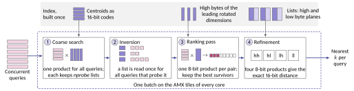
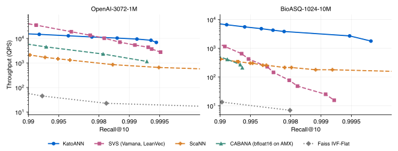
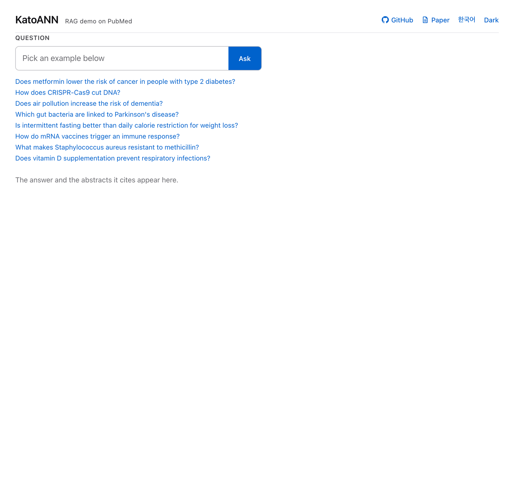
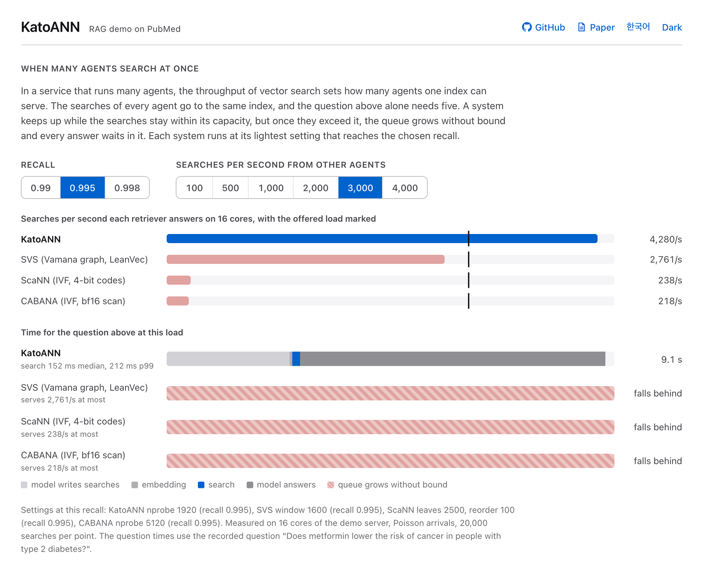

<p align="center">
  
</p>

<h1 align="center">KatoANN</h1>

<p align="center">
  <b>Shared near-exact scans for high-recall vector search, on the matrix engines inside server CPUs.</b>
</p>

<p align="center">
  <a href="LICENSE"></a>
  
  
  <a href="https://arxiv.org/abs/2610.27508"></a>
</p>

<p align="center">
  <a href="#quick-start">Quick start</a> · <a href="#how-it-works">How it works</a> · <a href="#results">Results</a> ·
  <a href="#demo">Demo</a> · <a href="#usage">Usage</a> · <a href="#reproducing-the-results">Reproducing the results</a> · <a href="#tests">Tests</a> ·
  <a href="#citation">Citation</a>
</p>

---

KatoANN is an approximate nearest neighbor (ANN) search system for embedding vectors at high recall on CPUs, with a
C++ API, a Python module, and a command-line tool. It uses an inverted-file (IVF) index: k-means splits the vectors
into lists, and each query scans the lists whose centroids are nearest to it.

When many queries arrive together, KatoANN scans each list once for all the queries that probe it, as matrix products
on Intel AMX, the matrix engine inside each core of recent Xeon CPUs. AMX multiplies 8-bit integers or bfloat16
numbers. KatoANN stores every dimension as a 16-bit code split into a high byte and a low byte, so four 8-bit products
give the exact product of two codes. The search therefore ranks its final candidates by exact distances between 16-bit
codes, which agree with float32 distances almost everywhere, while bfloat16 keeps only 8 significant bits.

## At a glance

- **Recall@10 of 0.991 at 6,600 queries per second** on 10 million BioASQ embeddings of 1,024 dimensions, on 32
  cores: 5.7 times the Vamana graph of SVS and 16 times ScaNN on the same server.
- **The gap to the graph grows with recall.** On BioASQ, KatoANN answers 4,800 queries per second at recall 0.995 and
  2,700 at 0.999, where SVS answers 229 and 25; on 990,000 OpenAI embeddings of 3,072 dimensions, KatoANN is 1.8 times
  faster than SVS at recall 0.999.
- **2 bytes per dimension and no float32 copy in memory.** The index of the 10 million BioASQ vectors takes 26 GB of
  memory; the float32 vectors alone take 41 GB.

## How it works

<p align="center"></p>

A batch of queries goes through four steps on the cores of the server.

1. **Coarse search as one product.** The centroids are 16-bit codes too, so the distances from every query of the batch
   to every centroid come from one matrix product. Each query keeps its `nprobe` nearest lists.
2. **Inversion.** For every list, KatoANN collects the queries that probe it. A list that 300 queries probe is read once
   from memory, not 300 times.
3. **Ranking pass.** The vectors and queries are rotated once to their principal axes (PCA), which puts most of the
   variance in the leading dimensions. KatoANN ranks every candidate of a list by the distance between the high bytes
   of the leading dimensions, one 8-bit product per pair, and keeps the best `survivors` (32 by default) per query.
4. **Refinement.** For each query, KatoANN gathers its survivors into one block and computes their exact 16-bit
   distance with four 8-bit products, then returns the nearest `k`.

The rotation is orthogonal, so it preserves distances. The index keeps no float32 copy of the vectors in memory: 2
bytes per dimension for the codes, a copy of the high bytes of the leading dimensions for the ranking pass, and 36
bytes per vector for its id, position, and norms. Without AMX, the same code runs the products on AVX-512 VNNI and
returns the same results.

## Results

Recall@10 against throughput on one server with two Xeon Silver 4514Y CPUs (32 cores, SMT off). Every system runs
on the same machine with the same queries, ground truth, and 32 threads, and takes the queries in batches of 4,096.
Each curve is the best throughput a system reaches at each recall over its swept settings.

<p align="center"></p>

Highest throughput (queries per second) at recall@10 of at least 0.99, 0.995, and 0.999. A dash marks a target the
system did not reach in its sweep.

| Dataset | Recall@10 | KatoANN | SVS | ScaNN | CABANA | Faiss IVF-Flat |
|---|---:|---:|---:|---:|---:|---:|
| OpenAI-3072-1M | 0.99 | 14,662 | **34,699** | 2,113 | 4,509 | 45 |
| | 0.995 | 12,806 | **18,745** | 1,314 | 2,316 | 23 |
| | 0.999 | **9,409** | 5,356 | 656 | 1,152 | 12 |
| BioASQ-1024-10M | 0.99 | **6,615** | 1,160 | 424 | 411 | 14 |
| | 0.995 | **4,826** | 229 | 304 | – | 7 |
| | 0.999 | **2,703** | 25 | 180 | – | – |

On BioASQ-1024-10M, KatoANN is 5.7, 21, and 107 times faster than SVS at recall 0.99, 0.995, and 0.999, and 15 to 16
times faster than ScaNN at all three. On OpenAI-3072-1M, the SVS graph is faster below recall 0.998, the two are even
at 0.998, and KatoANN is 1.8 times faster at 0.999. SVS reaches recall 0.99 with a search window of 100 on
OpenAI-3072-1M but needs a window of 6,400 on BioASQ-1024-10M.

**OpenAI-3072-1M**: 990,000 DBpedia entities embedded with OpenAI text-embedding-3-large (3,072 dimensions) and
10,000 queries. **BioASQ-1024-10M**: 10 million PubMed abstracts of the BioASQ benchmark (1,024 dimensions) with
its 3,106 queries. KatoANN uses 2,048 and 8,192 lists, ranks on the first 768 and 512 rotated dimensions, keeps 32
survivors per query, and sweeps `nprobe`.

The baselines:

- **SVS** 0.5.0 (`scalable-vs`): the Vamana graph of Intel's Scalable Vector Search over LeanVec, which searches
  8-bit LVQ codes of a PCA projection (768 dimensions for OpenAI, 256 for BioASQ) and reranks with float16 vectors.
  Graph degree 64 and build window 200; the sweep varies the search window.
- **ScaNN** 1.4.2: Google's partitioned index with the same number of leaves as KatoANN's lists, anisotropic 4-bit
  codes over pairs of dimensions, and exact reordering; the sweep varies leaves searched and reorder depth.
- **CABANA**: our implementation of the CABANA design, which scans the probed lists in bfloat16 with matrix products on
  AMX (oneMKL `cblas_gemm_bf16bf16f32`, pip package `mkl` 2026.2.0) over the same lists as KatoANN.
- **Faiss IVF-Flat** 1.15.1 (`faiss-cpu`): float32 scans of the probed lists, with the same number of lists.

`baselines/` holds the CABANA code and `baselines/bench.py`, which builds and measures SVS, ScaNN, Faiss, and hnswlib
with the batches, threads, and output of `katoann search`.

## Demo

**[Try the recorded demo in your browser](https://gyuyeongkim.github.io/KatoANN-public/).** A retrieval-augmented
generation (RAG) demo with KatoANN as the retriever over 10 million PubMed abstracts (BGE-M3 embeddings). The page
replays eight recorded questions, each after the time it took, and needs no server.

For each question, a language model writes four search queries. KatoANN finds the nearest abstracts for them and the
question in one batch with recall above 0.99, and the model answers from those abstracts and cites them.

<p align="center"></p>

A second panel shows many agents searching one index: how many searches per second KatoANN, SVS, ScaNN, and CABANA
answer on 16 cores at recall 0.99, 0.995, and 0.998 (CABANA does not reach 0.998), and how long a question takes as the
load grows.

<p align="center"></p>

## Quick start

```sh
git clone https://github.com/GyuyeongKim/KatoANN-public.git
cd KatoANN-public
cmake -B build
cmake --build build -j
ctest --test-dir build
./examples/quickstart.sh
```

The script makes 200,000 synthetic 768-dimensional vectors with exact ground truth, builds an index with 512 lists,
and reports recall@10 and throughput for four `nprobe` values.

> [!NOTE]
> The build targets the CPU it runs on (`-march=native`), so build on the machine that searches.

**You need**

- Linux on x86-64 with AVX-512 VNNI and BF16. AMX comes with Xeon CPUs of the 4th generation or later and needs Linux
  5.16 or later; `grep -c amx_int8 /proc/cpuinfo` prints a nonzero count on such a CPU.
- CMake 3.20 or later, GCC 11 or later with OpenMP, and OpenBLAS (`libopenblas-dev`) for k-means. tcmalloc
  (`libgoogle-perftools-dev`) is linked when present.
- Python 3 with numpy for the example script.

KatoANN is tested on a Xeon Silver 4514Y with Ubuntu 24.04, Linux 7.1, GCC 13.3, and OpenBLAS 0.3.26.

## Usage

### Build an index

```sh
build/katoann build --data base.fbin --out index/openai --nlist 2048 --normalize
```

`base.fbin` holds a 4-byte vector count, a 4-byte dimension, and the float32 vectors. `--normalize` scales every vector
to unit length, so that L2 distance ranks like cosine similarity, and records it in the index; searches then normalize
the queries too. Building runs k-means on a sample of 256,000 vectors (`--train-size`), assigns every vector to its
nearest centroid, and computes the rotation from a sample of 100,000 vectors.

### Measure recall and throughput

```sh
build/katoann search --index index/openai --queries query.fbin --gt gt.bin --k 10 --nprobe 128,256,512
```

Each `nprobe` value prints one JSON line with the throughput and, with `--gt`, recall@k. The queries go in batches of
4,096 (`--batch`), after one untimed pass; the throughput is the median of three timed passes (`--repeat`).

<details>
<summary><b>All search options</b></summary>

| Option | Default | Meaning |
|---|---|---|
| `--k K` | `10` | Neighbors per query |
| `--nprobe LIST` | `64` | Lists scanned per query, comma-separated for a sweep |
| `--ranking R` | `prefix` (`full` with `bf16`) | `prefix`: rank by the high bytes of the leading dimensions; `high`: by the high bytes of all dimensions; `full`: exact distance of every candidate |
| `--survivors S` | `32` | Candidates refined per query |
| `--prefix-dims D` | from the index | Leading dimensions of the ranking pass, a multiple of 64 |
| `--selection M` | `threshold` | `threshold`: one running top-S per query; `local`: a top-S per query and list, merged after the scan |
| `--engine E` | `amx` | `amx` or `avx512`; AVX-512 is used when AMX is unavailable |
| `--precision P` | `sq16` | `sq16`: 16-bit codes; `bf16`: bfloat16 vectors with a full scan, for comparison |
| `--coarse C` | `batched` | `batched`: centroid distances as one product per batch; `flat`: per query in float32 |
| `--gt FILE` | | Ground truth; adds recall@k to the output |
| `--batch B` | `4096` | Queries searched together |
| `--repeat R` | `3` | Timed passes; the median is reported |
| `--threads T` | all | OpenMP threads |
| `--query-ids FILE` | all | Search only these query rows |
| `--out PREFIX` | | Write the ids and distances of each `nprobe` to `PREFIX.np<N>.bin` |

</details>

### Serve an arrival stream

```sh
build/katoann load --index index/openai --queries query.fbin --nprobe 512 --rate 8000 --requests 50000
```

Requests arrive as a Poisson process at `--rate` per second. Whenever the index is idle, it answers every request
that has arrived as one batch, up to `--max-batch` (4,096), so batches grow with the load and a request that arrives
alone is answered alone. The output reports the achieved throughput and the 50th, 95th, and 99th percentile latency
from arrival to answer.

### Python

```sh
pip install .
```

```python
import numpy as np
import katoann

katoann.build(base, "index/openai", nlist=2048)          # base: (n, dim) float32
index = katoann.Index()
index.load("index/openai")
ids, dists = index.search(queries, k=10, nprobe=512)     # queries: (m, dim) float32
```

`search` releases the GIL, so a server thread can collect requests while another searches.

## Reproducing the results

```sh
./scripts/reproduce.sh
```

The script downloads both datasets (`scripts/datasets.py`: OpenAI-3072-1M from Qdrant on Hugging Face with a fixed
holdout of 10,000 queries, BioASQ-1024-10M from VectorDBBench), computes the ground truth of OpenAI-3072-1M with
faiss, builds the indexes of KatoANN and three of the baselines (CABANA scans KatoANN's lists), measures recall and
throughput over the settings of the figure, and draws `results/recall_throughput.svg`. It needs Python 3 with numpy,
pyarrow, huggingface_hub, faiss-cpu, scalable-vs, and matplotlib, and scann in the same or another Python
(`SCANN_PYTHON`); CABANA is built against oneMKL (`MKLROOT`, for example a virtual environment with `pip install mkl
mkl-include`). `DATASETS` and `SYSTEMS` select a subset, for example `DATASETS=openai3072-1m SYSTEMS="katoann scann"
./scripts/reproduce.sh`, and `THREADS`, `DATA`, and `OUT` set the threads and the directories. A finished build or
measurement is kept, so running the script again only does what is missing.

On the test server with 32 threads, a full run with the datasets already converted took 3.6 hours and peaked at
121 GB of memory. It needs about 290 GB of disk: 44 GB of downloaded Parquet files, 51 GB of vectors in `.fbin` files, and
190 GB of indexes, 150 GB of them for BioASQ-1024-10M. `scripts/datasets.py` holds the 41 GB of BioASQ
vectors more than once while it converts them.

## Tests

```sh
ctest --test-dir build
```

`test_kernels` checks that the AMX and AVX-512 kernels equal the scalar 64-bit integer formula for the 16-bit codes,
for 1 to 16 queries, 1 to 256 vectors (including partial tiles), 64 to 3,072 dimensions, and byte values 0 and 255.
`test_index` builds an index over synthetic clustered vectors and checks recall against brute force, identical answers
from AMX and AVX-512 for every ranking mode, that the ranking pass equals the full scan when 4,000 of the 40,000
candidates survive, and that both selection methods return the same neighbors.

## Source tree

```
include/katoann/index.h    index API: build, load, search, options
include/katoann/kernels.h  AMX and AVX-512 kernels for 16-bit codes and bfloat16
src/index.cpp              IVF build, quantization, rotation, batched search
src/kernels.cpp            kernels
src/kmeans.cpp             k-means++ and Elkan's k-means
tools/katoann.cpp          command-line tool: build, search, load
python/katoann_module.cpp  Python module
tests/                     kernel and index tests
examples/                  synthetic data and quick start
scripts/                   datasets, measurements, and figures
baselines/                 CABANA and the benchmark driver for SVS, ScaNN, Faiss, and hnswlib
```

## Citation

KatoANN is described in [KatoANN: Enabling Near-Exact Vector Search at the Speed of Lossy Scans with CPU Matrix
Engines](https://arxiv.org/abs/2610.27508).

```bibtex
@article{cho2026katoann,
  title   = {{KatoANN}: Enabling Near-Exact Vector Search at the Speed of Lossy Scans with {CPU} Matrix Engines},
  author  = {Cho, Soobin and Kim, Gyuyeong},
  journal = {arXiv preprint arXiv:2610.27508},
  year    = {2026},
  doi     = {10.48550/arXiv.2610.27508}
}
```

## License and contact

Copyright 2026 Gyuyeong Kim (Yonsei University). Licensed under the Apache License, Version 2.0 (see `LICENSE` and
`NOTICE`).

Questions and bug reports: Soobin Cho (tnqls40168@gmail.com) and Gyuyeong Kim, Yonsei University
(gyuyeong.kim@yonsei.ac.kr)
